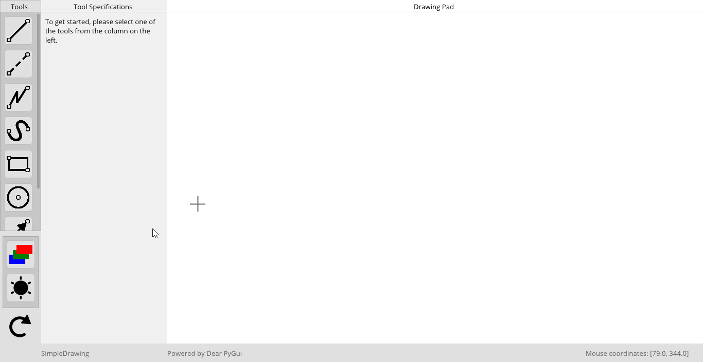

# SimpleDrawing

A Windows desktop drawing app built with Python and Dear PyGui. Sketch freehand, draw shapes, add text and images, and save drawings for later editing.



## Features

- Freehand doodles, straight and dashed lines, and open or closed polylines.
- Rectangles, circles, arrows, and four-point Bézier curves.
- Adjustable colors, line thickness, shape fills, rectangle rounding, and text size.
- Text placement and JPEG/PNG image insertion.
- Shift constraints for horizontal, vertical, or 45-degree lines, square rectangles, and image aspect ratios.
- Canvas background colors and light/dark interface themes.
- Undo, redo, and a reset command to clear the drawing pad.
- Editable SQLite drawing files and JPEG, PNG, or PDF exports.

## Requirements

- Windows: the app imports `win32gui` and `win32con` for window and file-dialog handling.
- Python with Tkinter and support for the pinned dependencies. The source uses `list[float]` annotations, which require Python 3.9 or later.
- A graphical desktop session for the interface and screenshot-based exports.

This is a legacy application. It uses the `dearpygui.core` and `dearpygui.simple` APIs and pins Dear PyGui to `0.6.268`. Newer Dear PyGui APIs are incompatible with this source. The pinned packages are old; installation on newer Python versions may require a compatible older interpreter.

## Setup and launch

Open PowerShell in your local checkout of this repository. Create a virtual environment using an interpreter compatible with the pinned packages:

```powershell
python -m venv .venv
.\.venv\Scripts\python.exe -m pip install -r requirements.txt
.\.venv\Scripts\python.exe -m pip install pywin32
.\.venv\Scripts\python.exe SimpleDrawing.py
```

`requirements.txt` pins Dear PyGui, PyAutoGUI, and Pillow. Install `pywin32` separately because the application imports it but it is missing from that file.

Run the app from the repository root so it can find the bundled `icons/` and `fonts/` directories.

## Drawing

1. Select a tool from the left toolbar.
2. Adjust its settings in the **Tool Specifications** panel and click **Apply** to use the updated values.
3. Follow the panel's instructions to place points or draw on the canvas. Tools activate with default settings when selected.
4. Use right-click or Escape to finish or cancel, as described by the selected tool.
5. Use the canvas color and theme controls to change the background and interface appearance.

Hold **Shift** while positioning supported lines to constrain their direction, while drawing rectangles to make squares, or while placing images to preserve their aspect ratio.

### Keyboard shortcuts

| Shortcut | Action |
| --- | --- |
| Ctrl+O | Open an editable drawing |
| Ctrl+S | Save or export a drawing |
| Ctrl+Z | Undo |
| Ctrl+Y | Redo |

## Saving and opening drawings

Use **File → Save drawing** and explicitly include the desired extension in the filename:

| Format | Purpose |
| --- | --- |
| `.db` | Save drawing commands in a SQLite database for later editing. |
| `.jpg` / `.jpeg` | Export a JPEG image. |
| `.png` | Export a PNG image. |
| `.pdf` | Export a PDF containing a raster image of the drawing. |

Use **File → Open drawing** to reopen a saved `.db` file. To place a JPEG or PNG on the canvas, use the image tool.

The app stores its active drawing history in `SimpleDrawingTemp_db.db` in the working directory. That history is reset at startup, so save a separate `.db` file before closing if you want to continue editing later. Inserted images are recorded by file path; keep the original image files available when reopening drawings.

Image and PDF exports capture the screen and crop a fixed rectangle. Display scaling, window placement, and screen resolution can affect the result; check the exported file after saving.

## Project layout

```text
SimpleDrawing.py       Application entry point, interface, and tool callbacks
ToolSpecTemplate.py    Shared tool settings panel
db_manage.py          SQLite drawing history, undo/redo, and persistence
tools/                Drawing tools, file dialogs, and keyboard shortcuts
icons/                Toolbar icons for light and dark themes
fonts/                Bundled Open Sans font
readme_demo/           Demo animation
requirements.txt      Pinned Python dependencies
```

## License

Released under the [MIT License](LICENSE). Copyright (c) 2021 RahulShagri.
